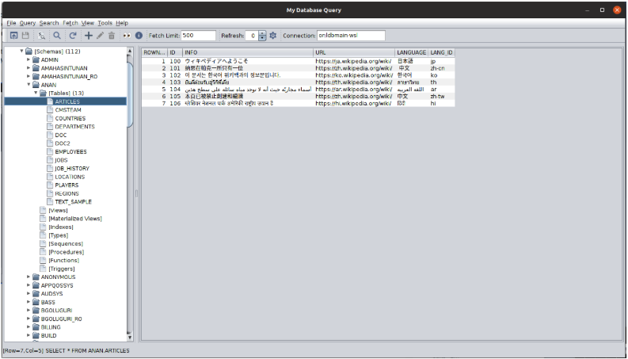

# MyQuery2 v2.1 — JDBC Desktop Query Tool



**MyQuery2** ("My Database Query App") is a desktop SQL client written in Java Swing using JDBC drivers. It allows users to configure and persist connections to multiple databases — Oracle, PostgreSQL, SDB, and MySQL — whether local or remote. Users can write SQL queries manually or use the built-in UI to generate statements. They can explore database objects (tables, views, indexes, etc.), perform related tasks, and import or export table definitions and data across the same or different databases. Administrators can monitor database information such as locks, long-running queries, and CPU/memory/disk usage (Oracle only), and can terminate rogue queries that monopolize system resources.

## What's in this package

| File | Description |
|------|-------------|
| `myquery.jar` | Application JAR |
| `myquery2.sh` | Linux/Mac launcher |
| `myquery2.bat` | Windows launcher |
| `myquery.xml` | Driver configuration |
| `myquery.ini` | JAVA_HOME config |
| `log4j2.xml` | Logging config |
| `jdbc/` | JDBC driver jars (PostgreSQL bundled) |
| `misc/` | Runtime dependency jars |

## Supported databases

| Database | Driver | Bundled? | Where to get |
|----------|--------|----------|--------------|
| PostgreSQL | `org.postgresql.Driver` | Yes (BSD) | Bundled |
| Oracle | `oracle.jdbc.driver.OracleDriver` | No | [Oracle JDBC](https://www.oracle.com/database/technologies/appdev/jdbc-downloads.html) |
| MySQL | `com.mysql.cj.jdbc.Driver` | No | [MySQL Connector/J](https://dev.mysql.com/downloads/connector/j/) |

## Quick start

Prerequisite: JDK 17+

```bash
# Linux/macOS
./myquery2.sh

# Windows
.\myquery2.bat
```

If `java` is not on your PATH, set `JAVA_HOME` in `myquery.ini`.

## Adding a JDBC driver

1. Download the driver jar from the vendor (see table above)
2. Place it in the `jdbc/` directory
3. The launcher scripts auto-detect jars in `jdbc/`

## Features

- Tree-based connection browser with schema/table/views/indexes navigation
- SQL editor with multi-statement support
- Paginated query results (configurable fetch limit)
- Table import and export: XML, CSV, HTML (XSL), DDL generation
- LOB cell inspection: MIME type detection, text/image/HTML render, content download
- Content detect, translate, and dump for LOB/CLOB/BLOB columns
- Detect encoding for file content
- Explain plan / execution plan per database backend
- Long running queries and lock info
- List statistics and bind variable support
- Server monitor: CPU, memory, disk, and table usage charts
- Language & character set detection (Apache Tika)

> **Note:** The "Source code" links above are auto-generated by GitHub and contain the same binaries as this repository — no actual source code is included. For source, see the private [MyQuery2-mvn](https://github.com/amahasintunan/MyQuery2mvn) repository.

